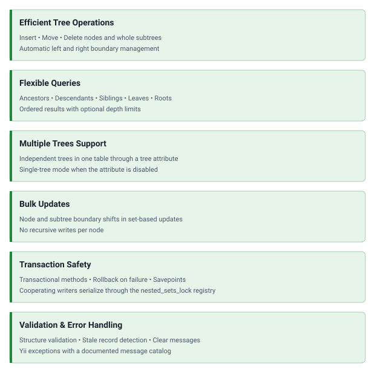

<!-- markdownlint-disable MD041 -->

<p align="center">
    <a href="https://github.com/yii2-extensions/nested-sets-behavior" target="_blank">
        
    </a>
    <h1 align="center">Nested sets behavior</h1>
    <br>
</p>

<p align="center">
    <a href="https://github.com/yii2-extensions/nested-sets-behavior/actions/workflows/build.yml" target="_blank">
        
    </a>
    <a href="https://dashboard.stryker-mutator.io/reports/github.com/yii2-extensions/nested-sets-behavior/main" target="_blank">
        
    </a>
    <a href="https://github.com/yii2-extensions/nested-sets-behavior/actions/workflows/static.yml" target="_blank">
        
    </a>
    <a href="https://github.com/yii2-extensions/nested-sets-behavior/actions/workflows/security.yml" target="_blank">
        
    </a>
</p>

A powerful behavior for managing hierarchical data structures using the nested sets pattern in Yii ActiveRecord models.

Efficiently store and query tree structures like categories, menus, organizational charts, and any hierarchical data
with high-performance database operations.

## Features

<picture>
    <source media="(min-width: 768px)" srcset="./docs/svgs/features.svg">
    
</picture>

## Database support

[](https://github.com/yii2-extensions/nested-sets-behavior/actions/workflows/build-mssql.yml)
[](https://github.com/yii2-extensions/nested-sets-behavior/actions/workflows/build-mysql.yml)
[](https://github.com/yii2-extensions/nested-sets-behavior/actions/workflows/build-oracle.yml)
[](https://github.com/yii2-extensions/nested-sets-behavior/actions/workflows/build-pgsql.yml)
[](https://github.com/yii2-extensions/nested-sets-behavior/actions/workflows/build.yml)

## How it works

The nested sets model is a technique for storing hierarchical data in a relational database. Unlike adjacency lists
(parent_id approach), nested sets enable efficient tree operations with minimal database queries.

1. **Creates root nodes** using the nested sets pattern with `lft`, `rgt`, and `depth` fields.
2. **Manages hierarchy** automatically when inserting, moving, or deleting nodes.
3. **Optimizes queries** using boundary values for efficient tree traversal.
4. **Supports transactions** to ensure data integrity during complex operations.

**Why nested sets?**

- **Fast queries**: Get all descendants with a single query (`lft BETWEEN parent.lft AND parent.rgt`).
- **Efficient tree operations**: No recursive queries needed for tree traversal.
- **Automatic maintenance**: Left/right boundaries are calculated automatically.
- **Depth tracking**: Easy to limit query depth or build breadcrumbs.

```text
Example tree structure:
Electronics (1,12,0)
├── Mobile Phones (2,7,1)
│   └── Smartphones (3,6,2)
│       └── iPhone (4,5,3)
└── Computers (8,11,1)
    └── Laptops (9,10,2)

Numbers represent: (left, right, depth)
```

### Installation

```bash
composer require 'yii2-extensions/nested-sets-behavior:^0.2@dev'
```

See the [installation guide](docs/installation.md) for Composer setup and the Yii version constraints.

### Database setup

The package includes ready-to-use migrations for creating the necessary database structure.

#### Quick setup (Recommended)

**1. Configure console application:**

```php
<?php

declare(strict_types=1);

use yii\console\controllers\MigrateController;

// console/config/main.php
return [
    'controllerMap' => [
        'migrate' => [
            'class' => MigrateController::class,
            'migrationPath' => [
                '@console/migrations',
                '@vendor/yii2-extensions/nested-sets-behavior/migrations',
            ],
        ],
    ],
];
```

**2. Run migrations:**

```bash
./yii migrate/up --migrationPath=@vendor/yii2-extensions/nested-sets-behavior/migrations
```

This creates the example `tree` and `multiple_tree` tables and the required `nested_sets_lock` registry. For an existing
application or a different model table, copy only `m261016_000001_nested_sets_lock.php` and any desired example
migration into your application's migration directory, adjust the example table name, and run `./yii migrate/up`. Create
one unprefixed lock registry in each database schema containing a nested set table. See
[writer locking](docs/configuration.md#concurrent-writers) and the [upgrade guide](UPGRADE.md) before deployment.

#### Table structures created

The SQL below summarizes columns and indexes; the migrations generate driver-specific primary keys and table options.

**Single tree** (`m250707_103609_tree.php`). Creates a `tree` table for single hierarchical structure.

```sql
CREATE TABLE tree (
    id INTEGER NOT NULL PRIMARY KEY,
    name VARCHAR(255) NOT NULL,
    lft INTEGER NOT NULL,
    rgt INTEGER NOT NULL,
    depth INTEGER NOT NULL
);

CREATE INDEX idx_tree_lft ON tree (lft);
CREATE INDEX idx_tree_rgt ON tree (rgt);
CREATE INDEX idx_tree_depth ON tree (depth);
CREATE INDEX idx_tree_lft_rgt ON tree (lft, rgt);
```

**Multiple trees** (`m250707_104009_multiple_tree.php`). Creates a `multiple_tree` table for multiple independent trees.

```sql
CREATE TABLE multiple_tree (
    id INTEGER NOT NULL PRIMARY KEY,
    tree INTEGER DEFAULT NULL,
    name VARCHAR(255) NOT NULL,
    lft INTEGER NOT NULL,
    rgt INTEGER NOT NULL,
    depth INTEGER NOT NULL
);

CREATE INDEX idx_multiple_tree_tree ON multiple_tree (tree);
CREATE INDEX idx_multiple_tree_lft ON multiple_tree (lft);
CREATE INDEX idx_multiple_tree_rgt ON multiple_tree (rgt);
CREATE INDEX idx_multiple_tree_depth ON multiple_tree (depth);
CREATE INDEX idx_multiple_tree_tree_lft_rgt ON multiple_tree (tree, lft, rgt);
```

### Quick start

Add the behavior to your ActiveRecord model. This example maps to the `tree` migration above.

```php
<?php

declare(strict_types=1);

use yii\db\ActiveRecord;
use yii2\extensions\nestedsets\NestedSetsBehavior;

/**
 * @property int $depth
 * @property int $id
 * @property int $lft
 * @property int $rgt
 */
class Category extends ActiveRecord
{
    public static function tableName(): string
    {
        return '{{%tree}}';
    }

    public function behaviors(): array
    {
        return [
            'nestedSets' => [
                'class' => NestedSetsBehavior::class,
                // 'treeAttribute' => 'tree', // Enable for multiple trees
                // 'leftAttribute' => 'lft',   // Default: 'lft'
                // 'rightAttribute' => 'rgt',  // Default: 'rgt'
                // 'depthAttribute' => 'depth', // Default: 'depth'
            ],
        ];
    }

    public function transactions(): array
    {
        return [
            self::SCENARIO_DEFAULT => self::OP_ALL,
        ];
    }
}
```

#### Creating and building trees

```php
<?php

declare(strict_types=1);

// Create root node
$root = new Category(['name' => 'Electronics']);
$root->makeRoot();

// Add children
$phones = new Category(['name' => 'Mobile Phones']);
$phones->appendTo($root);

$computers = new Category(['name' => 'Computers']);
$computers->appendTo($root);

// Add grandchildren
$smartphone = new Category(['name' => 'Smartphones']);
$smartphone->appendTo($phones);

$laptop = new Category(['name' => 'Laptops']);
$laptop->appendTo($computers);
```

#### Querying the tree

```php
<?php

declare(strict_types=1);

// Get all descendants of a node
$children = $root->children()->all();

// Get only direct children
$directChildren = $root->children(1)->all();

// Get all ancestors of a node
$parents = $smartphone->parents()->all();

// Get all leaf nodes (nodes without children)
$leaves = $root->leaves()->all();

// Navigate siblings
$nextSibling = $phones->next()->one();
$prevSibling = $computers->prev()->one();
```

#### Moving nodes

```php
<?php

declare(strict_types=1);

// Move as last child
$smartphone->appendTo($computers);

// Move as first child
$smartphone->prependTo($phones);

// Move as next sibling
$smartphone->insertAfter($laptop);

// Move as previous sibling
$smartphone->insertBefore($laptop);

// For a model configured with treeAttribute, a node can become a separate root:
// $smartphone->makeRoot();
```

#### Deleting nodes

```php
<?php

declare(strict_types=1);

// Delete node only (children become children of parent)
$phones->delete();

// Delete node with all descendants
$computers->deleteWithChildren();
```

#### Query builder integration

Add query behavior for advanced tree queries.

```php
<?php

declare(strict_types=1);

use yii\db\ActiveQuery;
use yii2\extensions\nestedsets\NestedSetsQueryBehavior;

/**
 * @template T of Category
 *
 * @extends ActiveQuery<T>
 */
class CategoryQuery extends ActiveQuery
{
    public function behaviors(): array
    {
        return [
            'nestedSetsQuery' => NestedSetsQueryBehavior::class,
        ];
    }
}

```

In your `Category` model:

```php
/**
 * @return CategoryQuery<static>
 */
public static function find(): CategoryQuery
{
    return new CategoryQuery(static::class);
}
```

Now you can use enhanced queries.

```php
<?php

declare(strict_types=1);

// Find all root nodes
$roots = Category::find()->roots()->all();

// Find all leaf nodes
$leaves = Category::find()->leaves()->all();
```

## Documentation

Practical guides and complete examples for safe tree operations.

- 📚 [Installation Guide](docs/installation.md): Composer setup for either Yii branch.
- ⚙️ [Configuration Guide](docs/configuration.md): attributes, transactions, and writer locking.
- 💡 [Usage Examples](docs/examples.md): creation, traversal, movement, and deletion.
- 🔄 [Upgrade Guide](UPGRADE.md): required migrations and compatibility actions.
- 🧪 [Testing Guide](docs/testing.md): checks, isolated fixtures, and concurrency tests.

The guides are available in [`docs/`](docs/), and the API is documented by the PHPDoc in `src/`. Publication on the
[documentation site](https://yii2-framework.github.io/docs/) is pending.

## AI assistance

AI agents: read the [documentation index](https://yii2-framework.github.io/docs/llms.txt) and fetch the Markdown version
of a page by appending `index.md` to its URL. The
[AI agents guide](https://yii2-framework.github.io/docs/project/ai-agents/) covers skill installation, client setup and
verification.

- 🤖 [`yii2-nested-sets` skill](docs/agents.md): Nested set trees.
- 🧭 [`yii2-framework` skill](https://yii2-framework.github.io/docs/guide/skills/yii2-framework/): Yii 22.0 application
  conventions.

The hosted documentation covers Yii 22.0. If it does not match the installed revision or is unavailable, use the
[repository guides](#documentation), the [skill source](skills/yii2-nested-sets/SKILL.md), the source PHPDoc and the
[changelog](CHANGELOG.md).

## Package information

[](https://www.php.net/releases/8.3/en.php)
[](https://github.com/yiisoft/yii2/releases/tag/2.0.55)
[](https://github.com/yiisoft/yii2/tree/22.0)
[](https://packagist.org/packages/yii2-extensions/nested-sets-behavior)
[](https://packagist.org/packages/yii2-extensions/nested-sets-behavior)

## Project status

[](https://codecov.io/github/yii2-extensions/nested-sets-behavior)
[](https://github.com/yii2-extensions/nested-sets-behavior/actions/workflows/static.yml)
[](https://github.com/yii2-extensions/nested-sets-behavior/actions/workflows/quality.yml)
[](https://github.styleci.io/repos/717718161?branch=main)

## Our social networks

[](https://x.com/Terabytesoftw)
[](https://www.facebook.com/wilmer.arambula.9)
[](https://www.reddit.com/r/Yii2/)
[](https://t.me/yii_framework_in_english)

## License

[](LICENSE)

## Fork

This package is a fork of [https://github.com/creocoder/yii2-nested-sets](https://github.com/creocoder/yii2-nested-sets)
with some corrections.
